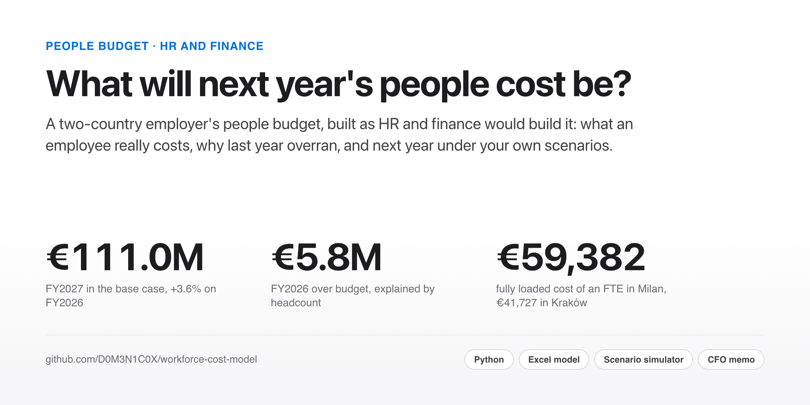
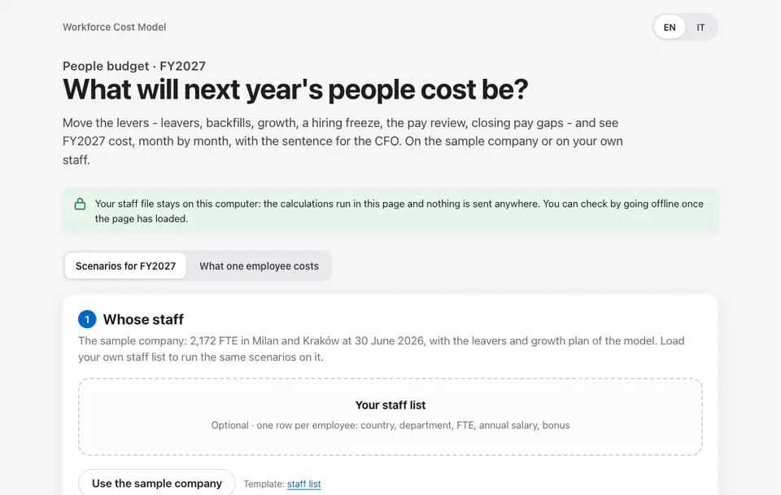
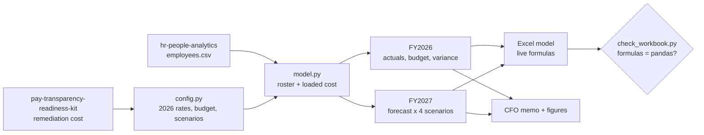

<picture>
  <source media="(prefers-color-scheme: dark)" srcset="site-assets/cover-dark.png">
  
</picture>

<p align="center">
  <a href="https://d0m3n1c0x.github.io/workforce-cost-model/simulator/"><b>Try the scenario simulator</b></a> ·
  <a href="https://d0m3n1c0x.github.io/workforce-cost-model/">Read the CFO memo</a> ·
  <a href="https://github.com/D0M3N1C0X/workforce-cost-model/raw/main/deliverables/workforce_cost_model.xlsx">Excel model</a>
</p>

<p align="center">
  <a href="https://github.com/D0M3N1C0X/workforce-cost-model/actions/workflows/ci.yml"></a>
  
  
</p>

## Why this matters

People are most of the cost base, and the budget for them is usually a spreadsheet nobody can audit: an
average salary times a headcount, a percentage for "on-costs", and a variance explained after the fact. This model
answers the questions a finance director actually asks, for an employer in **Milan and Kraków**, **as HR and finance
would build it together**: what does one person really cost in each country, why did last year's people budget
overrun, and what will next year cost if we freeze hiring, lose more people or start closing pay gaps?

> **Synthetic company, real rules.** The employees are the organisation analysed in
> [hr-people-analytics](https://github.com/D0M3N1C0X/hr-people-analytics); the budget, growth plans and pay review are
> invented. Italian and Polish employer costs follow the 2026 rules (German and Spanish ones too, in the calculator),
> each with its source and status in the [verification register](docs/verification.md). Not payroll or tax advice.

## The answer, for the finance director

| | |
|---|---|
| **FY2026 closed €5.8M (5.7%) over budget, at €107.1M**, for 2,128 FTE on average. Volume explains it: headcount ahead of plan added €6.3M. | **A fully loaded employee costs €59,382 per FTE in Milan and €41,727 in Kraków.** In Poland, 79 people earn above the 282,600 PLN cap on pension and disability contributions. |
| **FY2027 costs €111.0M in the base case (+3.6%)**: more FTE and the January pay review. | **A hiring freeze from October cuts it to €104.6M**, but the year ends with 278 fewer FTE than the base case: a capacity decision, not a finance one. |
| **Higher attrition barely moves payroll** but lifts recruitment cost to €1.54M. | **Closing pay gaps from January 2027 adds €0.76M** to FY2027 and €1.52M a year after, using the gaps found by [pay-transparency-readiness-kit](https://github.com/D0M3N1C0X/pay-transparency-readiness-kit). |


## Run your own scenarios

The simulator moves the levers a budget meeting argues about (leavers, backfills, growth, a hiring freeze, the pay
review, closing pay gaps) and shows FY2027 month by month, the bridge from last year and the sentence for the CFO,
with up to five scenarios side by side. It runs on the sample company or on a client's own staff list, which never
leaves the computer, and it also tells you what one employee costs in Italy, Poland, Germany and Spain, item by item.

<p align="center"><a href="https://d0m3n1c0x.github.io/workforce-cost-model/simulator/"></a></p>

## What you get

| Deliverable | For | What is in it |
|---|---|---|
| [`workforce_cost_model.xlsx`](deliverables/workforce_cost_model.xlsx) | the finance team | Fourteen sheets: dashboard with a scenario picker, scenario summary and bridge, FY2026 variance, actuals and budget, FY2027 drivers, one forecast sheet per scenario, the employee roster, settings and a reconciliation sheet. **Every figure is a live formula**: change a contribution rate, an attrition multiplier or a hiring-freeze month and the model recalculates. |
| [Scenario simulator](https://d0m3n1c0x.github.io/workforce-cost-model/simulator/) | the HR business partner and finance, in the budget meeting | Levers for leavers, backfills, growth, a hiring freeze, the pay review and closing pay gaps; FY2027 month by month, the bridge and the sentence for the CFO; up to five scenarios side by side; an Excel download. Runs on the sample company or on a client's own staff list, and **the file never leaves the computer**. Also: what one employee costs in Italy, Poland, Germany and Spain, item by item. English and Italian. |
| [`cfo_memo.md`](reports/cfo_memo.md) | the finance director | Answer first: where the FY2026 budget went, what an employee costs in each country, FY2027 under four scenarios, five recommendations, method and limits. |
| [`docs/method.md`](docs/method.md) · [`docs/verification.md`](docs/verification.md) | reviewers | Every formula and simplification; the source and status of every rate and cap. |

## The judgement calls

- **A person's cost is loaded with every employer contribution**, ceiling by ceiling: INPS and TFR in Italy; ZUS with
  its annual 30-times cap, the Labour Fund, FGŚP and PPK in Poland. "Salary plus 30%" is the error this replaces.
- **The variance is split into volume, mix and rate**, and the parts add up exactly to the overrun: the finance
  director sees that headcount, not pay, explains last year.
- **Fiscal years run July to June**, so FY2026 ends on the date of the source snapshot, and a month is its month-end
  payroll.
- **The forecast moves FTE, not people**: leavers follow last year's attrition, 90% are replaced after two months,
  planned growth comes on top.
- **Recruitment cost is kept apart from payroll**, so higher attrition shows its real price instead of looking like a
  saving.
- **Closing pay gaps is priced with on-costs**, from the gaps found by the
  [pay transparency kit](https://github.com/D0M3N1C0X/pay-transparency-readiness-kit), and starts before the first
  reports are due.

Every formula and simplification is in [docs/method.md](docs/method.md).

## Built to be checked

| | |
|---|---|
| **Three engines, one answer** | pandas, the Excel model's live formulas (reconciled on 570 checks, recalculated in CI by LibreOffice) and the browser simulator (checked against the model on 9,679 values) |
| **Every rate sourced** | a [verification register](docs/verification.md) with the source, its status and the date each rate and ceiling was read |
| **A client-ready workbook** | inputs in blue, formulas in black, key assumptions in yellow, one Settings sheet, a scenario picker, no dynamic arrays |
| **Reproducible** | one command rebuilds every output; CI fails if a rebuilt file differs from the committed one |

<details>
<summary><b>For engineers: how it fits together, how to run it</b></summary>



```bash
python3 -m venv .venv && . .venv/bin/activate
pip install -r requirements.txt
python src/run_all.py        # a few seconds
pip install -r requirements-dev.txt
pytest                       # includes a sample workbook calculated in pure Python
node tests/js/check_engine.mjs   # the simulator against the model
```

The reconciliation check, the LibreOffice recalculation and the byte-stable workbook come from
[excel-twin](https://github.com/D0M3N1C0X/excel-twin), a small library shared by the portfolio.

```
├── data/source/employees.csv    the organisation from hr-people-analytics (checksum pinned)
├── src/
│   ├── config.py                every rate, cap and assumption, with its source
│   ├── model.py                 roster, actuals, budget, variance, forecast, bridge
│   ├── build_workbook.py        the Excel model and its reconciliation sheet
│   ├── check_workbook.py        proves the formulas reproduce pandas
│   ├── recalc_libreoffice.py    recalculates the workbook headless, for CI
│   ├── build_memo.py            the memo and its figures
│   ├── charts.py                four SVG charts in the portfolio identity, light and dark
│   ├── report_html.py           the memo as one HTML page
│   ├── deterministic.py         byte-stable Office files
│   └── run_all.py               the whole pipeline
├── deliverables/                the workbook
├── reports/                     the memo, its HTML page and figures
├── docs/                        method and verification register
└── tests/
```

</details>

## About

Built by **Domenico Perroni**: HR advisory for the Italian market, people analytics and reward, based in Kraków.
[GitHub](https://github.com/D0M3N1C0X) · [LinkedIn](https://www.linkedin.com/in/domenico-perroni) · [Portfolio](https://d0m3n1c0x.github.io/)

**More from the same portfolio**

- [pay-transparency-readiness-kit](https://github.com/D0M3N1C0X/pay-transparency-readiness-kit) — the EU Pay Transparency Directive run end to end on the same organisation: a live Excel model reconciled with pandas, a board briefing and a readiness checklist, with the [report online](https://d0m3n1c0x.github.io/pay-transparency-readiness-kit/); its remediation cost feeds this model
- [equal-value-pay-ranges](https://github.com/D0M3N1C0X/equal-value-pay-ranges) — from family pay bands to one range per grade and country for the same organisation: Eurostat market pricing for four countries, a live Excel model reconciled with pandas, and a [pay range finder](https://d0m3n1c0x.github.io/equal-value-pay-ranges/ads.html) for job ads
- [controlli-cedolini](https://github.com/D0M3N1C0X/controlli-cedolini) — the Italian payroll side in practice: fourteen checks on monthly payslips under the CCNL Terziario, terminations included, in Python, a Google Sheets-ready workbook and a browser tool, with the cost of the November 2026 pay increase; the tool in English and Italian
- [where-pay-transparency-bites](https://github.com/D0M3N1C0X/where-pay-transparency-bites) — Eurostat data for all 27 Member States, analysed in R: the published gender pay gap understates the gap inside sectors; [article](https://d0m3n1c0x.github.io/where-pay-transparency-bites/), [dashboard](https://d0m3n1c0x.github.io/where-pay-transparency-bites/dashboard/) and [working paper](https://d0m3n1c0x.github.io/where-pay-transparency-bites/paper.pdf)
- [hr-people-analytics](https://github.com/D0M3N1C0X/hr-people-analytics) — attrition drivers, EU pay-transparency exposure and HR service-desk performance on the synthetic 4,000-employee organisation used here, with the [report online](https://d0m3n1c0x.github.io/hr-people-analytics/)
- [engagement-survey-analytics](https://github.com/D0M3N1C0X/engagement-survey-analytics) — an employee engagement survey analysed end to end, with a [live dashboard](https://d0m3n1c0x.github.io/engagement-survey-analytics/) you can filter in the browser
- [job-search-agent](https://github.com/D0M3N1C0X/job-search-agent) — a job search run as a pipeline: public ATS board APIs, explainable fit scoring, funnel analytics
- [pompei-stratificata](https://github.com/D0M3N1C0X/pompei-stratificata) — Pompeii and Herculaneum from AD 79 to today, a [walkable model](https://d0m3n1c0x.github.io/pompei-stratificata/) with a sourced documentary dossier, in six languages

MIT licensed. Reuse anything here.
